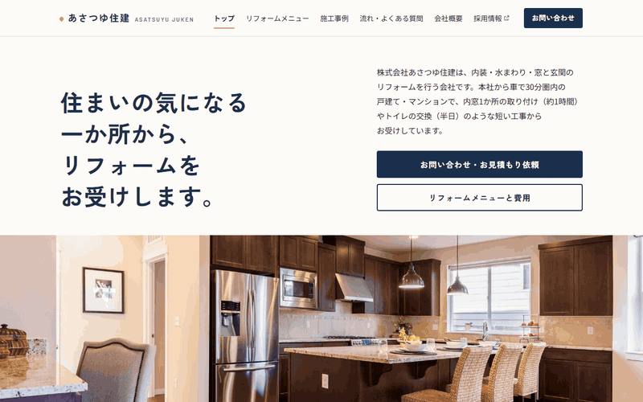

# あさつゆ住建 会社サイト（架空）

制作実績（ポートフォリオ）用に作った、**実在しない架空の会社**「株式会社あさつゆ住建」の会社サイトです。地域の住宅リフォーム会社という設定で、実在の会社ではありません。お問い合わせ・お見積もりはできません（全ページのフッターにも同じ旨を表示しています）。

**公開ページ：https://tmy-adc329.github.io/asatsuyu-site/**

## デモ

`index.html` をブラウザで直接開くだけで表示できます（ビルド不要）。

## これは何

これまで作ってきた1ページのLPとは違い、7ページの会社サイト（Webサイト）の作例です。地域の小さな会社の「ホームページ制作（数ページ）」の依頼を想定しています。

会社は、採用LP（https://tmy-adc329.github.io/asatsuyu-lp/ ）と同じ架空の「株式会社あさつゆ住建」です。会社の設定・色・フォント・テキストロゴは採用LPとそろえ、レイアウトは別に組んでいます。メニューの「採用情報」から採用LPへリンクしています。

想定する読み手は、本社から車で30分圏内に住み、築15〜30年くらいの戸建て・マンションの一部を直したい人です。問い合わせの前に気にすることとして、次の5つに順に答える構成にしています。

1. いくらかかるのか分からない
2. こんな小さな工事を頼んでいいのか
3. 見積もりを頼んだら断りにくそう、しつこく営業されそう
4. 工事中の生活はどうなるのか
5. 誰が工事に来るのか、工事のあとに何かあったらどうするのか

## ページ構成

| ファイル | ページ | 主な中身 |
|---|---|---|
| `index.html` | トップ | できる工事（3分類）、リフォームの特徴（3点）、施工事例（3件）、ご相談から工事までの流れ、採用情報への案内、お問い合わせの案内 |
| `service.html` | リフォームメニュー | 内装・水まわり・窓と玄関ごとに、工事の内容・工期の目安・費用の目安（税込）の表 |
| `works.html` | 施工事例 | カード6枚のレイアウトのみ。内装・水まわり・窓と玄関で絞り込むボタン |
| `flow.html` | リフォームの流れ・よくある質問 | お問い合わせから工事のあとまでの7段階と、よくある質問6問 |
| `company.html` | 会社概要 | 会社情報の表、代表あいさつ（レイアウトのみ）、アクセス（地図は仮表示） |
| `contact.html` | お問い合わせ | フォームと、電話番号・受付時間 |
| `privacy.html` | プライバシーポリシー | 見本として作成（実際の内容はクライアントが確認して決める前提） |

- CSSは `style.css`、JavaScriptは `script.js` の1つずつにまとめ、全ページから読み込んでいます
- ヘッダー（ロゴ・メニュー・お問い合わせボタン）とフッターは全ページ同じ内容です。今いるページはメニューで分かるようにしています（`aria-current="page"`）
- スマートフォン幅から組み始め、タブレット・PC幅へ広げています。スマホではメニューを開閉式にしています
- ページ間のリンクは相対パスで書いています（GitHub Pages のサブフォルダでも、ファイルを直接開いても動くように）

## お問い合わせフォーム

フォームは**ダミー送信**です。送信しても実際には送られず、入力内容をブラウザのコンソールに出し、画面に「デモのため実際には送信されていません」と表示するだけです。

- 項目：ご相談の種類／工事したい場所（複数選択）／お名前／ご希望の連絡方法（電話・メール）／電話番号／メールアドレス／お住まいの市区町村／ご相談内容（任意）
- 電話番号とメールアドレスは、「ご希望の連絡方法」で選んだほうだけが必須になります
- 送信ボタンの近くに個人情報の利用目的を書き、プライバシーポリシーへリンクしています
- SSGform などの送信サービスに後から差し替えやすいよう、素直な `<form>` にしています

## 表現のルール

リフォーム会社のサイトは、景品表示法・建設業法・消費税法（総額表示）・個人情報保護法に関わります。架空の作例ですが、実案件と同じルールで書いています。

- **価格は税込で表示**：費用はすべて税込の目安です。「〜円＋税」「税抜〜円」だけの表示はしていません。表の下に「費用は目安で、住まいの状態や選ぶ商品によって変わる」ことを添えています
- **二重価格を使わない**：「通常価格○円のところ○円」「定価の○％オフ」のような表示はしていません
- **根拠のない一番・最安を書かない**：「地域No.1」「業界最安値」「最高品質」などは使っていません
- **急かさない**：「今だけ」「先着○名」「残りわずか」は使っていません
- **作り話の事例・口コミを作らない**：施工事例は、名前・場所・金額・感想を作らず、カードのレイアウトだけにしています。お客様の声も載せていません（自社で書いた口コミを第三者の声のように見せると、2023年10月からステルスマーケティングとして景品表示法の不当表示にあたるため）
- **フリー素材を実績に見せない**：写真に「施工事例」「当社の施工」とは書かず、すべて「イメージ」と表示しています。ビフォーアフターの写真は使っていません
- **許可・保険・団体を名乗らない**：建設業許可の有無・許可番号、加入している保険、登録している団体は書かず、未確定の表示にしています
- **個人情報の利用目的を示す**：フォームで連絡先を集めるため、利用目的を送信ボタンの近くに書いています

代表者名・所在地・電話番号・メールアドレス・地図・工事の保証やアフター点検など、実際の情報が必要な箇所は、仮の文章や数字で埋めていません。`<!-- CLIENT: ... -->` コメントを付けたうえで、画面上でも点線の枠で未確定と分かるようにしています。

## 写真の出典

写真はすべて Unsplash / Pexels のフリー素材（商用利用可）で、クライアントから支給された写真とみなして使っています。Web表示用に縮小しています。

| ファイル | 撮影者 / サイト | 元の写真 |
|---|---|---|
| `images/01_hero_window-install.jpg` | Ksenia Chernaya / Pexels | https://www.pexels.com/photo/faceless-handyman-installing-window-in-new-house-5691550/ |
| `images/02_work_window-side.jpg` | Ksenia Chernaya / Pexels | https://www.pexels.com/photo/unrecognizable-workman-installing-window-in-new-apartment-5691521/ |
| `images/03_site_renovation-room.jpg` | Ksenia Chernaya / Pexels | https://www.pexels.com/photo/modern-flat-interior-with-doorway-during-renovation-process-5691533/ |
| `images/06_work_marking.jpg` | Craft Kitties / Unsplash | https://unsplash.com/photos/person-marking-wooden-board-with-pencil-GfYA6q5ESLI |
| `images/07_finish_kitchen.jpg` | Francesca Tosolini / Unsplash | https://unsplash.com/photos/brown-and-beige-kitchen-interior-lIVK3z606og |
| `images/08_finish_hallway.jpg` | Josh Lemmon / Unsplash | https://unsplash.com/photos/hallway-with-grey-walls-and-doors-jHLMUAW-nFc |
| `images/10_tools_rack.jpg` | Barn Images / Unsplash | https://unsplash.com/photos/assorted-handheld-tools-in-tool-rack-t5YUoHW6zRo |
| `images/11_bg_wood-floor.jpg` | Alex Cooper / Unsplash | https://unsplash.com/photos/close-up-of-a-wooden-parquet-floor-pattern-K6vkTjYciX8 |
| `images/12_water_powder-room.jpg` | Francesca Tosolini / Unsplash | https://unsplash.com/photos/white-vanity-sink-567zvjtXxNY |
| `images/13_water_bathroom.jpg` | Josh Lemmon / Unsplash | https://unsplash.com/photos/bathroom-with-white-bathtub-and-vanity-Szqpq0YAhaI |
| `images/14_water_toilet.jpg` | Jan Antonin Kolar / Unsplash | https://unsplash.com/photos/white-toilet-bowl-with-cistern-xXc7zUKIhRw |
| `images/15_consult_swatches.jpg` | Karolina Grabowska / Unsplash | https://unsplash.com/photos/hand-holding-color-swatches-over-blueprints-and-open-book-pdCTX1harH4 |
| `images/16_survey_tape-measure.jpg` | Mark Owen Wilkinson Hughes / Unsplash | https://unsplash.com/photos/a-tape-measure-is-on-a-wooden-table-VdB1EHqEzX0 |

- 人が写っている写真は、顔が写っていないものだけを使い、「当社スタッフ」として見せないようにしています
- 浴室の写真（13）は海外の住宅のため、日本のユニットバスとは見た目が違います。実案件ではクライアントの写真に置き換える前提です

配色や構成の参考にはCanvaのテンプレートを複数見ましたが、テンプレートの画像や素材そのものは使っておらず、リポジトリにも含めていません。

## 技術スタック

- HTML / CSS / JavaScript（フレームワーク・ビルドツールなし）
- Google Fonts（Zen Kaku Gothic New / Noto Sans JP / Barlow）
- ブランドカラー（ネイビー）は `style.css` の `:root` の `--brand` 1行で変更できます

## 開発について

実装は Claude Code（AIコーディング支援）で行いました。仕様（会社の設定、ターゲット、ページ構成、料金表、表現のルール、写真の扱い、スコープ外の線引き）は [brief.md](./brief.md) にまとめ、それをもとに作っています。仕様の整理と、画面での最終確認は自分で行いました。

## 今回やらないこと（スコープ外）

- 実際のフォーム送信（ダミー送信）
- お知らせ・ブログなど、クライアントが自分で更新する機能（CMSが必要になるため）
- 地図の埋め込み（仮表示）
- 補助金の案内
- ロゴのデザイン（テキストロゴで代替）
- 多言語対応
- 構造化データなど、検索対策の作り込み（全ページ `noindex`）

## ライセンス

個人のポートフォリオ／学習プロジェクトです。現時点でライセンスファイルは設定していません（無断転載・改変・商用利用は不可）。写真の権利は各撮影者に帰属し、Unsplash License / Pexels License に従います。
